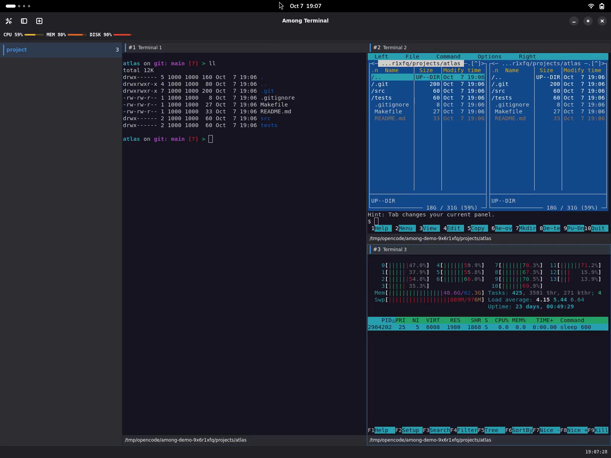

# Features in practice

Among Terminal keeps native VTE terminals in a single GNOME window. Use a
workspace for each project and split its terminals as needed.

The recordings show an earlier interface. The demonstrated pane and workspace
actions still apply, but action messages no longer appear as bottom popups.

## Split and resize terminals

Press `Ctrl+Shift+N` to split the focused pane. A wide pane splits side by side;
a tall pane splits top to bottom. The new shell starts in the original pane's
known directory. Drag a divider or use `Ctrl+Shift` with an arrow to move it.

The recording uses `ll`, `mc` and `htop` as examples. Among does not install
these tools. See [splitting a pane](/panes/#splitting-a-pane) and
[default shortcuts](/shortcuts/#defaults).

Watch [keyboard resizing](/media/features/02b-keyboard-resize.mp4) or
[mouse resizing](/media/features/02c-mouse-resize.mp4).

## Move panes and organize workspaces

Drag a pane header onto another pane's edge to rearrange the layout, or onto
a workspace in the sidebar to move the terminal there. Its running process
stays with it.

Watch [moving a pane by its header](/media/features/03-pane-drag.mp4).

Create a workspace with `Ctrl+Shift+T`. Double-click its name to rename it,
drag its entry to reorder it, or drag the sidebar's right edge to resize the
list. [Workspace controls](/panes/#workspaces) explain naming, ordering and
the collapsed sidebar.

Watch [creating, renaming and switching workspaces](/media/features/05-workspaces.mp4)
or [collapsing and expanding the sidebar](/media/features/05b-sidebar.mp4).

## Focus, expand and restore

Use `Alt+Arrow` to move between panes. `Ctrl+Shift+X` expands the focused pane
to fill its workspace. Press it again or use Restore pane in the header to
return to the layout. Hidden terminals keep running. Restore the layout before
splitting or moving focus with an arrow. `F11` toggles fullscreen.

See [expanding a pane](/panes/#expanding-a-pane).

Watch [moving focus](/media/features/04-focus.mp4),
[expanding and restoring a pane](/media/features/04b-zoom.mp4), or
[toggling fullscreen](/media/features/04c-fullscreen.mp4).

## Clipboard and links

Right-click a terminal or press `Shift+F10` for copy, paste and pane actions.
Use `Shift+right-click` when a terminal program handles mouse input.
`Ctrl+left-click` opens supported links with the desktop handler.

[The terminal menu and link guide](/panes/#terminal-context-menu) covers
selection, pasted commands and supported link types.

## Scrollback

Mouse-wheel scrolling follows VTE's row-based behaviour. Touchpad scrolling
uses the gesture's distance, converted to text rows. A full-screen editor,
pager or monitor receives scrolling as its own input. Each pane keeps its own
scroll position.

## Terminal notifications

An unfocused terminal can mark its pane and workspace when it rings a bell.
Desktop notifications can bring you back to the terminal that rang.

[Notification preferences](/preferences/#notifications) control when indicators,
desktop delivery, sound and configured commands run.

## Optional plugins

Install a clock, resource meters or per-pane directory labels from Settings.
Application packages contain no plugins. Each new installation stays disabled
until you review its access and enable it.

The screenshot includes sample plugins. See [official plugins](/plugins/#installing-official-plugins)
and [plugin protection](/plugins/#confinement) for the available functions and
their limits.

## Session restoration

On a new launch, choose Restore to reopen a saved layout in fresh shells.
Commands, running tools and scrollback are not resumed. See
[sessions](/sessions/) for saved state, directory reporting and recovery.

Watch [restoring a layout in fresh shells](/media/features/07-session-restore.mp4).
The recording runs `ll` manually after restoration.

## Closing a pane

Watch [closing a pane and continuing in its surviving sibling](/media/features/08-close-pane.mp4).
See [closing and exiting](/panes/#closing-and-exiting) for the controls and
confirmation rules.

## Appearance and keyboard controls

Choose text/background colours and an ANSI palette independently in
[Terminal preferences](/preferences/#terminal). Changes apply to open terminals
without restarting their shells. Configure your prompt in the shell itself.

The [Keyboard page](/shortcuts/#preferences) changes or removes bindings.
The [overview videos](/overview/) show earlier workflows; these written guides
cover the current controls without requiring video playback.
