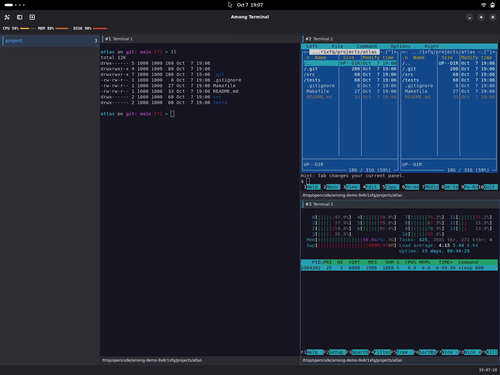
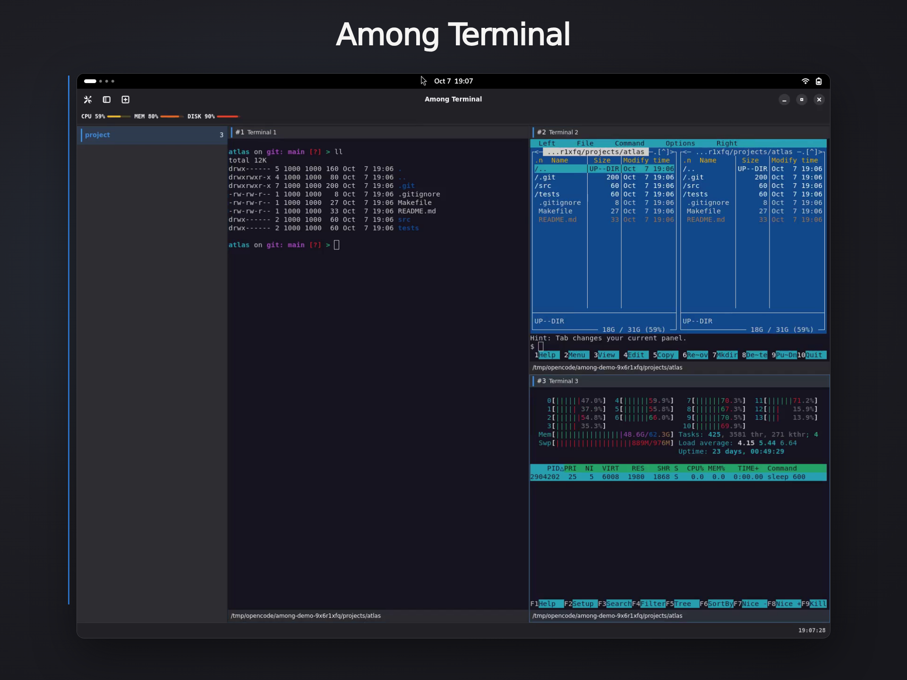

# Among Terminal overview

Among Terminal combines native VTE terminals, nested panes and workspaces in a
GNOME window. The [feature guide](/features/) explains the controls in 0.2.0.

## Workflow tour

[Watch or download the overview](/media/among-terminal-overview.mp4).

The silent tour covers themes, splitting and resizing, pane movement, focus,
zoom, fullscreen, workspace naming, sidebar controls, plugins, session
restoration and pane closing. Recorded shortcuts remain visible.

The recordings show the earlier plugin and appearance controls. Use the current
[plugin guide](/plugins/) and [preferences guide](/preferences/) for those controls.
The tools shown in the terminals, including Starship, `ll`, `mc` and `htop`,
are not installed or configured by Among.

## Extended presentation

[Watch or download the extended presentation](/media/among-terminal-promo.mp4).

## Current interface

Read about [panes and workspaces](/panes/), [sessions](/sessions/),
[keyboard shortcuts](/shortcuts/) and [installation](/install/).
